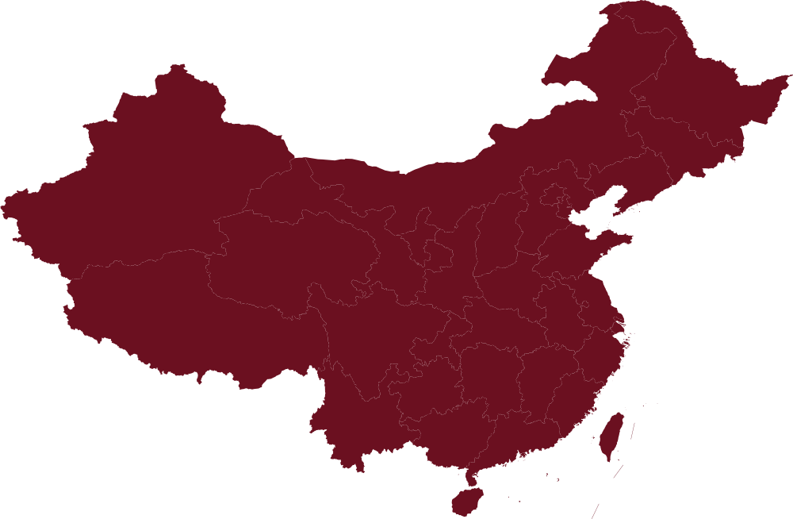
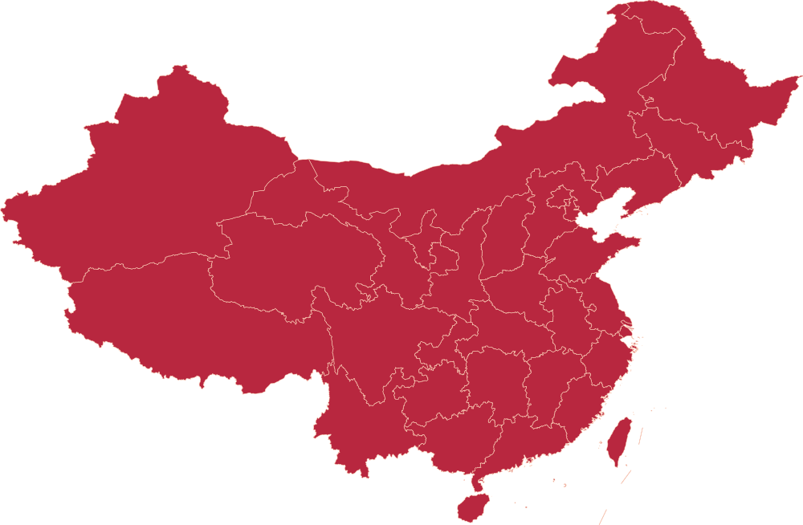

# 红色足迹地图 · 技术交接文件

> 交接对象：接手地图模块的开发者（GPT）
> 更新时间：2026-10-18
> 项目路径：`D:\XJTUpack\大一\班委\ai\团日活动\03_展示网站\`

---

## 一、背景与需求

**项目**：西安交通大学钱学森书院 储能2601 团支部「最佳团日」成果展示网站
**技术栈**：**纯静态 HTML/CSS/JS，无构建步骤、无后端、无 npm 依赖**
**部署**：GitHub Pages（`https://eqmarks.github.io/xjtu-es2601-web/`）
**必须离线可用**：所有资源相对路径，不能依赖 CDN

### 地图模块的需求（用户原话）

> "红色足迹部分要有一个 2.5D 地图展示"
> "2.5D地图是指中国地图啊"（不是手绘示意图，要**真实中国地图**）
> "地图这一块还是太拉了，你重新换个方案做一下，2d的也行，但是我想有厚度的感觉"

### 需求拆解

| 要求 | 说明 |
|---|---|
| **真实中国地图** | 必须是中国省界地图，35 个省份留下足迹（含台湾、港澳） |
| **有厚度感** | 不是扁平贴图，要有"地图板块被切开、有侧面厚度"的立体感 |
| **2D 可接受** | 不强制真 3D，但视觉上要有立体厚度 |
| **红色主题** | 站点主色 `#C8102E`（中国红），辅色 `#D4AF37`（金） |
| **可交互** | 悬停高亮、点击站点看详情卡片 |
| **必须清晰** | 任何屏幕缩放下不能糊 |
| **性能** | 首屏可接受（地理数据 569KB 已压缩） |

### 地图上要展示的内容

**3 处红色地标**（已实地走访，金色标记）：
| 名称 | 经纬度 | 时间 | 说明 |
|---|---|---|---|
| 西安 | 108.98, 34.26 | 2026-10-11 | 西迁博物馆、钱学森展、思源碑合影 |
| 西安事变纪念馆 | 108.98, 34.14 | 2026-10-06 | 英仔爱心社组织的红色研学 |
| 富平 | 109.18, 34.75 | 2026-10-17（意向） | 习仲勋故里党课 |

**1 个源起标记**：上海（121.47, 31.23）—— 交通大学 1896 年源起，金色星形

**31 个同学家乡点**：蓝色小点，散落全国（坐标见 `assets/data/map-marks.json`）

**2 条能量流路径**（可选，能加最好）：
- 上海 → 西安（西迁，1400 公里）
- 西安 → 富平（近距离）

---

## 二、⚠️ 已经踩过的坑（重要！请先读这一节）

### 坑 1：ECharts GL 的 `geo3D` + `lines3D`（已废弃）

**做法**：用 ECharts GL 的 3D 中国地图 + 飞线
**问题**：
- 渲染出来"太拉"（用户原话）——3D 省份挤出效果粗糙、光照奇怪
- 依赖重（`echarts.min.js` 1MB + `echarts-gl.min.js` 626KB）
- 样式难控

**结论**：❌ 不要再用 ECharts GL

### 坑 2：ECharts 2D + custom series 手绘挤出（未成功）

**做法**：用 `geo` 组件 + `custom` series 的 `renderItem`，用 `api.coord()` 拿屏幕坐标手绘挤出层
**问题**：
- `api.coord()` 在 `renderItem` 里返回 `undefined`（实测截图 + 日志验证）
- 这条路走不通

**结论**：❌ 不可行

### 坑 3：Canvas 2D 手绘挤出（代码正确但显示糊 —— 关键坑）

**做法**：`assets/js/map2d.js`，Canvas 2D 逐省逐环画 18 层向下偏移的暗色轮廓（侧面）+ 亮红顶面
**状态**：**代码逻辑完全正确**，但显示糊

**诊断过程（务必看，能省你几小时）**：

```javascript
// 关键验证方法：用 iframe 包住页面，直接读 canvas 内部像素
// 因为 headless Chrome 的截图会失真，但 canvas 内部数据不会
var fr = document.createElement('iframe');
fr.src = '/map3d.html';
// iframe onload 后：
var doc = fr.contentDocument;
var cv = doc.getElementById('cnmap');
var d = cv.getContext('2d').getImageData(cv.width/2, cv.height/2, 1, 1).data;
```

**验证结果**：
```
canvas 位图 = 1165×720 = CSS 显示尺寸 1165×720   → 比率 1.000 ✅
canvas 中心像素 = rgba(184,39,63)                 → 颜色精确正确 ✅
canvas 亮红像素占比 = 28.6%                        → 地图确实画出来了 ✅
toDataURL 导出的图像边缘锐利                      → 绘制代码没问题 ✅
```

**但截图（headless Chrome `--disable-gpu`）里地图是糊的、暗的。**

**结论**：
- ⚠️ **headless Chrome 的 `--disable-gpu` 软件合成会让 Canvas 显示层降质**，不能作为评判依据
- Canvas 方案本身**代码是对的**，在真实浏览器里应该是清晰的
- 但用户反馈"还是不行" —— 说明要么真实浏览器也有问题，要么用户不接受这个视觉

**当前文件**：`map3d.html` 用的就是这个 Canvas 方案（`assets/js/map2d.js`）

### 坑 4：Canvas 超采样反而害了它

**错误做法**：为了清晰，把 canvas 内部按 2 倍分辨率渲染（位图 2330×1440），CSS 显示 1165×720
**后果**：浏览器要把 2 倍大的位图**降采样**显示 → **整张图被"柔化"，糊且暗**
**修复**：`DPR = 1`，强制 `canvas.width === CSS 显示宽度`（已修复在 `map2d.js` 里）
**教训**：⚠️ **canvas 位图尺寸必须严格等于 CSS 显示尺寸，否则必糊**

---

## 三、当前文件清单

### 主文件

| 文件 | 大小 | 说明 | 状态 |
|---|---|---|---|
| `map3d.html` | 9 KB | 地图页面（当前用 Canvas 方案） | ✅ 可用，但视觉不满意 |
| `assets/js/map2d.js` | 20 KB | Canvas 2D 渲染器 | ✅ 逻辑正确 |
| `assets/data/china.geo.json` | 569 KB | **中国省界 GeoJSON（阿里 DataV 官方数据）** | ✅ 保留 |
| `assets/data/sites.json` | 2 KB | 旧版站点数据（已废弃，可删） | ⚪ 冗余 |
| `assets/data/map-marks.json` | 2 KB | **SVG 方案的站点/家乡坐标（百分比）** | ⭐ 新生成 |
| `assets/img/map-top.svg` | 334 KB | **SVG 顶面地图（亮红 + 浅金省界）** | ⭐ 新生成 |
| `assets/img/map-side.svg` | 333 KB | **SVG 侧面地图（深红纯色，用于叠层）** | ⭐ 新生成 |
| `assets/vendor/echarts.min.js` | 1 MB | ECharts（**地图不用了，但活动页/信息流可能用**） | ⚪ 保留 |
| `assets/vendor/echarts-gl.min.js` | 626 KB | ECharts GL（**已废弃，可删**） | ❌ 冗余 |

### 归档（不要动）

- `90_归档\map3d_旧版_EChartsGL.html` —— ECharts GL 版本备份
- `90_归档\redmap.js` —— 早期等距 SVG 版

### 生成脚本（在 `ai\tools\`）

| 脚本 | 作用 |
|---|---|
| `gen_svg_map.py` | **GeoJSON → SVG**，同时算标记坐标。**这是最有价值的产物** |
| `build_gallery.py` / `gallery_v2.py` / `gallery_v3.py` | 照片墙（与本模块无关） |

---

## 四、⭐ 推荐方案：SVG + CSS 3D 透视

**这是我已经设计好、素材也生成好、但还没来得及实现的方案。**

### 为什么这个方案最优

| 优势 | 说明 |
|---|---|
| **矢量、绝对清晰** | SVG 是矢量，任何缩放/任何屏幕都不糊 —— 彻底绕开 Canvas 的坑 |
| **真 3D 厚度** | CSS `perspective` + `rotateX` 让 SVG 平面产生真实透视倾斜；多层 `translateZ` 叠出厚度 |
| **零依赖** | 不需要任何库 |
| **性能好** | SVG 浏览器原生缓存，`` 引用同一文件只下载一次 |
| **可控** | 倾斜角、旋转角、厚度都能用滑块实时调 |

### 素材已生成（可直接用）

**`assets/img/map-top.svg`**（334 KB）
```xml
<svg xmlns="http://www.w3.org/2000/svg" viewBox="0 0 1000 654" preserveAspectRatio="xMidYMid meet">
  <path d="M...Z" fill="#B8273F" stroke="rgba(255,214,186,0.85)" stroke-width="0.6" fill-rule="evenodd"/>
  <!-- 35 个省份留下足迹，共 203 个路径段 -->
</svg>
```

**`assets/img/map-side.svg`**（333 KB）
```xml
<svg ...>
  <path d="M...Z" fill="#6B1020" stroke="none" stroke-width="0" fill-rule="evenodd"/>
</svg>
```

**`assets/data/map-marks.json`**
```json
{
  "viewBox": [1000, 654],
  "sites": [
    { "id": "xian",          "name": "西安",         "x": 57.60, "y": 54.27 },
    { "id": "xian-incident", "name": "西安事变纪念馆", "x": 57.60, "y": 54.61 },
    { "id": "fuping",        "name": "富平",         "x": 57.92, "y": 52.90 }
  ],
  "origin": { "name": "上海", "x": 77.88, "y": 62.79 },
  "homes": [ { "x": 65.13, "y": 52.90 }, ... ]   // 31 个点
}
```
> `x`/`y` 是**百分比**（相对地图容器的宽高），可直接用于 CSS `left` / `top`。

### 实现方案（可直接照做）

```html
<div class="stage" style="perspective:1500px; perspective-origin:50% 42%">
  <div class="slab" style="transform:rotateX(50deg) rotateZ(-3deg); transform-style:preserve-3d">

    <!-- 侧面层：10 层，逐层 translateZ 递减，越深越暗 -->
    <div class="layer" style="transform:translateZ(-2px);  opacity:0.98"></div>
    <div class="layer" style="transform:translateZ(-4px);  opacity:0.90"></div>
    <div class="layer" style="transform:translateZ(-6px);  opacity:0.82"></div>
    <!-- ... 共 10 层，每层间隔 2px，透明度递减 -->
    <div class="layer" style="transform:translateZ(-20px); opacity:0.30"></div>

    <!-- 顶面 -->
    <div class="layer top" style="transform:translateZ(0)">
      

      <!-- 家乡点：绝对定位，百分比坐标 -->
      <div class="home" style="left:65.13%; top:52.90%"></div>

      <!-- 站点：需要反向旋转，让标签"直立"（不跟着地图躺倒） -->
      <div class="marker" style="left:57.60%; top:54.27%">
        <div class="pin" style="transform:translate(-50%,-100%) rotateX(-50deg) rotateZ(3deg)">
          <span class="dot"></span>
          <span class="lbl">西安</span>
        </div>
      </div>

      <!-- 源起星标 -->
      <div class="origin" style="left:77.88%; top:62.79%">
        <div class="star"></div><span>上海 · 1896</span>
      </div>
    </div>
  </div>
</div>
```

**关键 CSS**：
```css
.stage{ perspective:1500px; perspective-origin:50% 42%; }
.slab{ transform-style:preserve-3d; transition:transform .4s; }
.layer{ position:absolute; inset:0; transform-style:preserve-3d; }
.layer img{ display:block; width:100%; height:auto; }
.layer.top{ position:relative; z-index:100; }
/* 标记反向旋转，保持直立 */
.marker .pin{
  transform-origin: 50% 100%;
  transform: translate(-50%,-100%) rotateX(-50deg) rotateZ(3deg);
}
```

**厚度调节**：改 `translateZ` 的间隔和层数即可。`depth=20px` 时视觉厚度刚好。

**推荐参数**：
| 参数 | 值 |
|---|---|
| `perspective` | `1500px` |
| 倾斜 `rotateX` | `50deg`（立体）／ `0deg`（俯视） |
| 旋转 `rotateZ` | `-3deg`（稍微歪一点更自然） |
| 厚度 | 10 层 × 2px = `20px` |
| 侧面 SVG 不透明度 | 从 0.98（最上层）递减到 0.30（最下层） |

---

## 五、如果要保留 Canvas 方案

`map3d.html` + `assets/js/map2d.js` 是**完整可用的 Canvas 实现**，功能包括：
- 逐省逐环挤出 18 层侧面 + 亮红顶面
- 拖动平移、滚轮缩放、双击复位
- 悬停省份高亮
- 点击站点立柱弹卡片
- 自动巡游
- 触屏双指缩放

**如果想继续用 Canvas，核心必须守住**：
```javascript
// resize() 里必须这样，绝不能用 DPR > 1
cv.width  = cssW;        // 位图宽 = CSS 宽
cv.height = cssH;        // 位图高 = CSS 高
cv.style.width  = cssW + 'px';
cv.style.height = cssH + 'px';
ctx.setTransform(1, 0, 0, 1, 0, 0);
```

**已知遗留问题**：用户反馈"还是不行"，可能是：
1. 真实浏览器里 canvas 也被降质（高分屏 `devicePixelRatio` 问题）
2. 视觉上不够"有厚度感"（18px 挤出在 700px 高的画布上占比小）
3. 颜色偏暗（背景 `#160508` + 省份 `#B8273F` 对比不够）

---

## 六、验证方法（重要工具）

### 1. 本地起服务（必须，不能 `file://` 打开）

```powershell
cd "D:\XJTUpack\大一\班委\ai\团日活动\03_展示网站"
C:\Users\EQ\.dsh\dsh-runtimes\dsh-primary-runtime\dependencies\python\python.exe -m http.server 8801
# 打开 http://127.0.0.1:8801/map3d.html
```

> 已有现成服务器脚本：`ai\tools\serve.py`（会显式声明 `charset=utf-8`）

### 2. 无头 Chrome 截图（看视觉效果）

```powershell
& "C:\Program Files\Google\Chrome\Application\chrome.exe" `
  --headless=new --disable-gpu --no-sandbox --hide-scrollbars `
  --window-size=1440,1100 --virtual-time-budget=10000 `
  --screenshot="D:\temp\map.png" `
  "http://127.0.0.1:8801/map3d.html"
```

⚠️ **注意**：`--disable-gpu` 会让 Canvas 显示降质。**SVG/CSS 方案不受影响，可以放心用这个方法验证。**

### 3. 真实像素校验（用于 Canvas 方案）

见「坑 3」的 iframe 方法 —— 绕开截图，直接读 canvas 内部像素。

---

## 七、设计约束（务必遵守）

| 约束 | 说明 |
|---|---|
| **站点主题色** | 主色 `#C8102E`（中国红），深红 `#8B0A1E`，金 `#D4AF37`，页面底色 `#FAF7F5`（暖白） |
| **夜/暗底地图** | 地图区可以用深色底 `#160508`，但整站是浅色 |
| **不能用 CDN** | 所有资源必须本地相对路径 |
| **无构建步骤** | 不能引入 npm / webpack / vite |
| **导航已固定 9 项** | 首页 / 支部概况 / 聚能·学 / 蓄势·思 / 传热·悟 / 释能·行 / 红色足迹 / 活动相册 / 材料下载 |
| **不要写没发生的事** | 之前误写"延安会合"，用户明确说"这个没有" —— **只展示真实举办的活动** |
| **日期以素材文件夹为准** | 不要自己推算日期 |
| **全班 31 人 / 团员 29 人** | 数据口径 |

---

## 八、其他页面（不要动，避免冲突）

地图模块只动 `map3d.html` + `assets/js/map2d.js` + `assets/img/map-*.svg` + `assets/data/map-marks.json`。

**其他页面已稳定**：
| 页面 | 内容 |
|---|---|
| `index.html` | 首页（四篇章卡片、宣传成果信息流、3D 地图引导卡） |
| `jn/xs/cr/sn.html` | 四篇章活动列表（数据驱动，读 `assets/data/activities.json`） |
| `photos.html` | 活动相册（21 个相册、127 张照片，按时间排序） |
| `activity.html` | 活动详情页模板（`?id=a01`，策划案位置已预留） |
| `about.html` | 支部概况 |
| `download.html` | 材料下载 |

**共享数据文件**：
- `assets/data/activities.json` —— 36 项活动（含 status/verified/dateKey）
- `assets/data/articles.json` —— 6 篇推文
- `assets/data/photo-map.json` —— 照片归属

---

## 九、给接手者的建议路线

**推荐：走 SVG + CSS 3D 方案**

1. ✅ **素材已备好** —— `map-top.svg` / `map-side.svg` / `map-marks.json` 直接能用
2. 按「第四节」的 HTML/CSS 结构写 `map3d.html`
3. 用「第六节」的 headless Chrome 截图验证（SVG 不受 `--disable-gpu` 影响）
4. 对照效果调参数：倾斜角、厚度层数、透明度梯度
5. 加上滑块控件让用户可以自己调视角（可选，但用户喜欢这种）
6. 完成后覆盖 `map3d.html`，全站导航已经指向它了

**预期视觉效果**：

```
     ╱▔▔▔▔▔▔▔▔▔╲        ← 顶面（亮红 #B8273F + 金色省界）
    ╱            ╲
   │  ▓▓▓▓▓▓▓▓▓▓  │      ← 侧面（10 层深红，越深越暗）
   │  ▓▓▓▓▓▓▓▓▓▓  │
    ╲____________╱
        ↑ 厚度 20px，通过 translateZ 叠出来
```

---

## 十、联系信息

- **用户**：班长/副支书 刘纪康（负责网站）
- **团支书**：董儒汉
- **项目状态**：网站已上线，仅地图模块待重做
- **截止时间**：最佳团日中后期，2026 年 10 月底前

---

*本文档由 AI 助手整理，记录了完整的尝试过程和诊断结论，希望能帮接手者少走弯路。*
